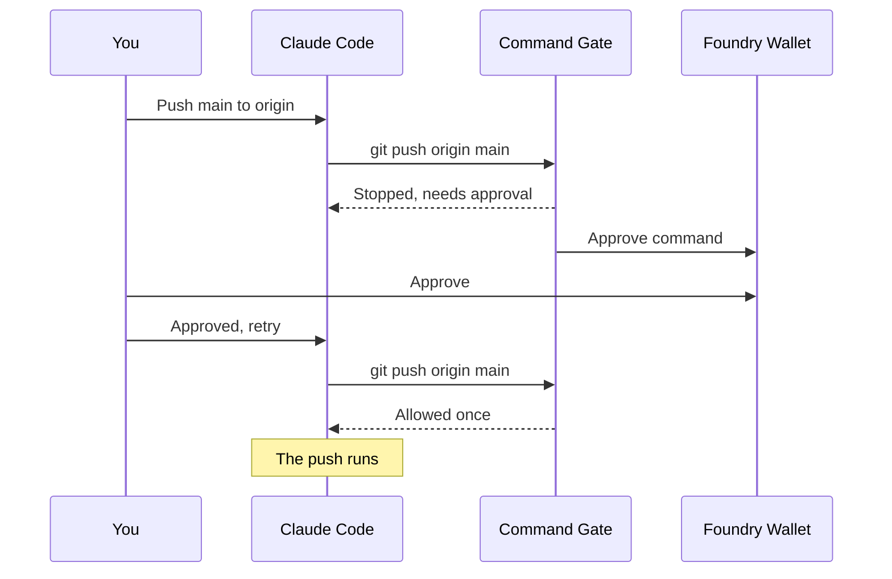

# Try the Foundry Command Gate

This guide takes you from installing the plugin to a command approved in Foundry Wallet, in about 15 minutes. It is for anyone evaluating the plugin, including directory reviewers. Nothing in it touches a real repository: every push goes to a local test copy on your machine.

## What you will see



## What you need

| Item | Where it comes from |
| --- | --- |
| Claude Code, signed in | claude.com/claude-code |
| Node.js 22 or newer, and Git | nodejs.org and git-scm.com. On Windows, Git for Windows, which includes Git Bash |
| Test tenant address and API key | Provided with this guide |
| Signing file for the test signer | Provided with this guide, a small JSON file |
| Foundry Wallet, signed in as the test signer | Provided with this guide |

Save the signing file where only you can write it, for example in your home folder. On macOS and Linux, run `chmod 600 signing.json`.

## 1. Install

```bash
claude plugin marketplace add Digital-Trust-Foundry/foundry-command-gate
claude plugin install foundry-gate@foundry-command-gate
```

Open Claude Code and run `/plugin configure foundry-gate@foundry-command-gate`. Enter:

| Setting | Value |
| --- | --- |
| Foundry endpoint | The test tenant address |
| API key | The test API key. Claude Code keeps it in the system keychain. |
| Signing file | The full path to `signing.json` |
| Gated commands | Leave the default, `git push, gh pr merge` |

Restart Claude Code after saving.

## 2. Make a test repository

```bash
mkdir gate-test && cd gate-test
git init --bare remote.git
git init -b main work && cd work
git commit --allow-empty -m "First commit"
git remote add origin ../remote.git
claude
```

The remote is a folder next to the repository, so the pushes below go nowhere else.

## 3. Approve a push

1. Ask Claude: *Push main to origin.* The push is stopped. Claude shows that the command needs approval in Foundry Wallet, with a short hash.
2. In Foundry Wallet, open **Approve command**. It shows the command, the folder, the branch and commit, and the same hash. Approve it.
3. Tell Claude: *Approved, retry the same command.* The push runs.
4. Ask Claude to push again. It is stopped again: an approval is used once, and a new request appears in the Wallet.

## 4. Reject a request

1. In Foundry Wallet, reject the request from step 3.4.
2. Ask Claude to retry. The gate reports that the signer rejected the command.
3. Ask Claude to retry once more. A new request appears in the Wallet.

## 5. A new commit needs a new approval

1. Ask Claude to push, and approve the request.
2. Before retrying, ask Claude to make another empty commit.
3. Ask Claude to retry the push. It is stopped with a new request, because the approval covered the earlier commit.

## 6. A command written around the gate

Ask Claude: *Run bash -c "git push origin main".* The command is refused straight away, without a Wallet request, and Claude is asked to run the plain command instead.

## What each message means

| The message says | What it means | What to do |
| --- | --- | --- |
| needs approval in Foundry Wallet | A request was opened | Approve it, then retry the identical command |
| The Wallet request is still waiting | It is not approved yet | Approve it, then retry |
| Foundry is still opening the request | The request takes a few seconds to create | Wait a moment, then retry |
| rejected this command or the request ran out of time | It was rejected or timed out | Retry to open a new request |
| expired after 15 minutes | It was approved but not used in time | Approve the new request |
| already used | Each approval runs the command once | Approve the new request |
| not signed by a person in Foundry Wallet | The signing file names a signer that signs on the server | Name only people who sign in Foundry Wallet |
| in a form the gate cannot check | The command was wrapped or hidden | Run the plain command |
| the plugin is not set up | A setting is empty | Run `/plugin configure`, then restart |
| Node.js 22 or newer is needed | Node.js is missing | Install Node.js |
| must not be writable by other users | The signing file's permissions are too open | Run `chmod 600` on it |
| stopped before the hook timeout | Foundry did not answer in time | Retry, and check the endpoint |

## Remove it

```bash
claude plugin uninstall foundry-gate@foundry-command-gate
claude plugin marketplace remove foundry-command-gate
```

## For directory reviewers

The test tenant address, the API key, the signing file and the sign-in for the test signer's Foundry Wallet are in the submission. Questions during the review go to info@digitaltrustfoundry.com.
